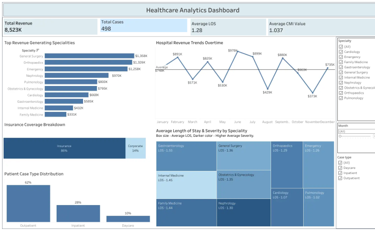
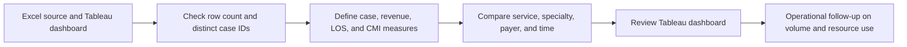

# Healthcare Analytics Dashboard

**Positioning:** Healthcare BI | **Source:** local workbook and Tableau Public dashboard

## Executive summary
The dashboard summarizes 500 encounter rows across service volume, revenue, case mix, and length of stay. It reports 498 distinct case numbers; that difference should be checked before using the case count as a unique-patient or encounter total.

## Business question and pipeline
How can operations monitor service volume and compare resource use and revenue across case types, specialties, payers, and time?

## Business KPIs

| Metric | Formula | Reported value | Interpretation |
|---|---|---:|---|
| Distinct cases | `COUNTD([Case_No])` | **498** | Unique case identifiers in the dashboard. The Excel source has 500 rows, so validate the two repeated IDs and whether they represent repeat encounters before treating this as a unique-case count. |
| Revenue | `SUM([Revenue])` | **8,523,364** (dashboard rounds to 8,523K) | Total recorded revenue. Currency is not identified in the source fields, so the README does not assign a currency symbol. |
| Average length of stay (LOS) | `AVG([LOS])` | **1.284 days** (displayed as 1.28) | Mean LOS per source row. Outpatient rows with LOS 0 lower the overall mean; compare inpatient/outpatient and specialty slices. |
| Average case-mix index (CMI) | `AVG([CMI Value])` | **1.037** | Average case-mix value. Read alongside a defined organizational benchmark; higher CMI generally signals a more complex resource mix. |

## Model Metrics

No predictive or statistical model is reported; this is a descriptive dashboard. Accuracy, AUC, and prediction error are **not applicable** to the current analysis.

## Insights
- 500 source rows resolve to 498 distinct case numbers; validate repeated IDs before making volume claims.
- The overall LOS and CMI are summaries only. They do not show which specialties, case types, or payers are driving the averages.
- The revenue total has no documented currency code in the source file.

## Recommendations
1. Reconcile repeated case numbers and document whether the KPI counts unique cases, visits, or rows.
2. Compare LOS by inpatient/outpatient status and specialty so zero-day outpatient cases do not obscure inpatient patterns.
3. Review revenue together with case mix and case type; confirm currency and avoid treating revenue alone as margin or efficiency.

## Project files
- My analysis uses the Excel source at `data/Hospital_Dashboard_Dataset.xlsx` to support my dashboard analysis.
- Repo contents: `README.md`, `data_visualization_and_analysis/`, `data/`, and `docs/`.

## Supporting documents

- [Executive summary](docs/Executive-Summary.md)
- [Business requirements summary](docs/BRD-Summary.md)
- [Functional requirements summary](docs/FRD-Summary.md)
